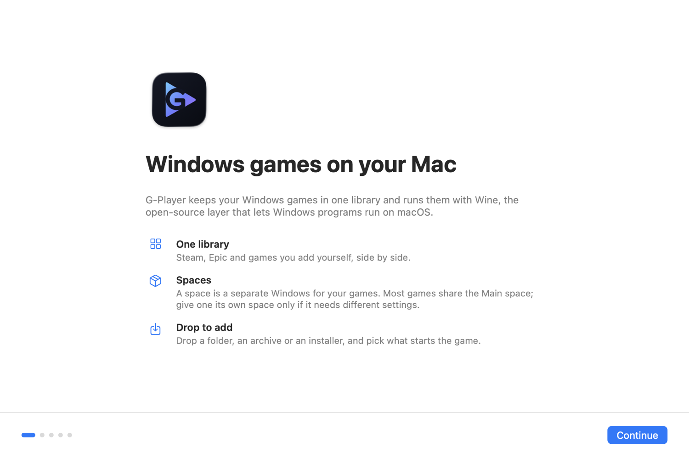

# G-Player

Play Windows games on an Apple Silicon Mac, for free. G-Player keeps your games in one library and runs
them with [Wine](https://www.winehq.org): Steam games, Epic games and games you add yourself, side by side.

<p align="center"></p>

- **One library.** Steam and Epic games show up on their own. Add any other game by dropping its folder,
  its zip/rar/7z archive or its installer onto the window.
- **Epic games without Epic's launcher.** Sign in on Epic's own page and install your Epic games with
  [Legendary](https://github.com/legendary-gl/legendary), an open-source Epic client (see [Epic Games](#epic-games-without-epics-launcher)).
- **Your library, your way.** Real icons read from each program, cover art for Steam games, and any game
  can be hidden and brought back later.
- **Spaces.** Each space is a separate Windows (a Wine prefix) with its own C: drive. Browse its files,
  run any program in it, and see exactly where everything lives on your Mac.
- **Steam that draws.** Steam's 2026 client shows a black window under plain Wine on macOS. G-Player fixes
  it the way MaPC does (see [How Steam works here](docs/HOW-STEAM-WORKS.md)).
- **Brings over what you have.** CrossOver bottles, Whisky bottles and hand-made prefixes are found on first
  launch and used in place, with their games and saves. G-Player asks once before it changes one of them.
- **No account, no telemetry.** G-Player talks to GitHub (engine downloads, Legendary, and whether a newer G-Player is out),
  the stores' own CDNs (installers, cover art), Epic when you sign in to Epic Games, the makers of Windows components when it
  installs them (Microsoft, NVIDIA…), and nothing else.

## Download

Get the latest `G-Player-<version>.dmg` from [Releases](https://github.com/RiperYT/g-player/releases)
(the same files are kept in [`releases/`](releases/)). Open it and drag **G-Player** onto **Applications**.
The app is signed with a Developer ID and notarized by Apple, so it opens like any other app. A newer version
goes over the old one the same way: your library, spaces and games stay where they are. Later versions arrive in the app
itself (**G-Player › Check for Updates…**); the automatic check can be turned off in **Settings › General**.

**Needs:** a Mac with Apple Silicon (M1 or later), macOS 15 Sequoia or later, Rosetta 2 (G-Player offers to
install it), about 3.0 GB for G-Player Wine (a download of about 640 MB) plus room for games.

## What runs

| Works | Doesn't work |
|---|---|
| Steam client and most DirectX 9–11 games through DXVK | Games with kernel anti-cheat (EasyAntiCheat, BattlEye, Vanguard) |
| Portable games, Unity, Unreal, Electron and RPG Maker games | Games that need a GPU driver Wine can't fake |
| DirectX 12 through Apple's D3DMetal on G-Player Wine, with Steam open (see below) | DirectX 12 without Apple's D3DMetal |
| 32-bit games, with G-Player's fixes for Wine; 32-bit DirectX 10/11 through DXVK since 0.3.5 (checked on a few Unity games so far) | OpenGL games that need more than OpenGL 4.1 (macOS's limit) |

The first minutes of a game can stutter while shaders compile. That settles once the cache is built.

When a game runs well, **Share What Worked…** in its panel opens a GitHub issue, filled in with the engine, graphics and
settings that worked, for you to read and submit; G-Player itself sends nothing.

### Epic Games without Epic's launcher

Epic's own launcher stops at its loading screen under Wine (it is still in **Get Apps**, for those who have it set up). The
way G-Player recommends for Epic is **Epic Games** in the sidebar:

1. **Sign In…** opens Epic's own sign-in page in a window. You sign in there, with Epic, Google, Apple or whatever you use. Your
   password goes to Epic and never to G-Player, which reads nothing on that page; it only takes the one-time code Epic's page
   gives the app that asked, and hands it to Legendary. The window keeps nothing. If you'd rather use your own browser, **Sign
   in in your browser instead** opens Legendary's page there and takes the code you paste.
2. The first time, G-Player downloads Legendary 0.21.1 (15 MB) from its GitHub release, checks it against a pinned SHA-256 and
   keeps it, with its settings and your login, in `Tools` in your library folder. It isn't part of G-Player: it runs as a separate
   program, and it is the same program Heroic Games Launcher uses.
3. The page lists the games your account owns. **Install** puts a game into a space of its own, "Epic Games", on G-Player Wine,
   one game at a time, with progress and a Stop in the sidebar (installing again goes on from where it stopped). **Play**
   starts it the way G-Player starts any game, with its graphics, components and automatic retry. Each start asks Epic for a
   one-time code to log the game in, so it needs your sign-in (offline, the game starts without the code, which most
   single-player games accept). **Uninstall…** is on the game's panel and on this page. **Sign Out** forgets the login on this Mac.

Not in this version: updating games, verify and repair, cloud saves, Epic's overlay, and the installers of a game's
prerequisites. Games with EasyAntiCheat or BattlEye don't run on a Mac. Legendary isn't made by Epic, and Epic hasn't published
a position on programs like it; G-Player doesn't get around any anti-cheat or protection. Legendary takes a few
seconds to start each time, so Play waits a moment before the game opens.

### Engines

- **G-Player Wine** (what new spaces run on): Wine 11 that G-Player builds from CodeWeavers' CrossOver 26.3 source
  ([scripts/build-engine-cx.sh](scripts/build-engine-cx.sh)), with DXMT (DirectX 10/11 straight to Metal), DXVK and
  GStreamer for game videos.
  CrossOver's Wine has what Apple's D3DMetal needs, so with D3DMetal (below) 64-bit DirectX 10–12 games run through
  it in the same space as Steam, with Steam signed in. G-Player Wine isn't CrossOver and isn't made by CodeWeavers.
- **Wine Staging 11.18** (Gcenx's build) with DXVK: open source, runs Steam and most DirectX 9–11 games. An advanced
  option for the rare game that needs a newer Wine: the first launch doesn't install it (G-Player Wine takes its
  libraries from Gcenx's download and deletes the archive), and **Settings › Engines › Advanced** installs or removes it.
- **Apple's Game Porting Toolkit**: Apple's own wine 7.7, if you installed it. Not an engine you can pick any more;
  spaces that already run on it keep running while it is installed and turned on. Steam doesn't run on it.

Nobody has to choose an engine: a new space gets G-Player Wine (or Wine Staging while that is the only engine
installed and G-Player Wine can't be downloaded). Turn on **Settings › Advanced › Choose the Wine engine for each
space** to pick between G-Player Wine and Wine Staging for each space. Spaces made before keep theirs: one on Wine
Staging or on the toolkit offers **Move to G-Player Wine…** on its page. Moving keeps the space's files, saves and
Steam login; G-Player asks first, since the other Wine updates the space for itself, and G-Player Wine's Wine 11.0 is
older than Wine Staging's 11.18, which a space that the newer one has updated may not open on. A space on an earlier
revision of G-Player Wine moves to the current one by itself once nothing runs in it: G-Player downloads the new
revision in the background first, and your games keep working on the old one meanwhile, offline too.

### Apple's D3DMetal (optional, off by default)

G-Player never includes, downloads or installs Apple's files. If you installed Apple's Game Porting Toolkit or
downloaded it from Apple, turn it on in **Settings › Engines**: G-Player copies D3DMetal from it, checking that
D3DMetal.framework and libd3dshared.dylib are signed by Apple, into your library and G-Player Wine. Apple's license allows the toolkit for developing,
testing and evaluating games; check that it fits how you use it. See [docs/LEGAL.md](docs/LEGAL.md).

## Build from source

Needs Xcode 16 or later.

```bash
make test   # unit tests, no Wine needed
make run    # builds build/G-Player.app and opens it
```

See [docs/ARCHITECTURE.md](docs/ARCHITECTURE.md) for how the code is organised and
[CONTRIBUTING.md](CONTRIBUTING.md) before sending a pull request.

## Credits

G-Player stands on other people's work:
[Wine](https://www.winehq.org) and [Wine Staging](https://wiki.winehq.org/Wine-Staging),
[Gcenx's macOS Wine builds and DXVK for macOS](https://github.com/Gcenx),
[DXVK](https://github.com/doitsujin/dxvk), [MoltenVK](https://github.com/KhronosGroup/MoltenVK), and
[MaPC's open-source MacadeKit](https://github.com/abduzeedo/mapc-engine) (Apache-2.0), where the Steam
helper wrapper comes from, and [Legendary](https://github.com/legendary-gl/legendary) (GPL-3.0), which G-Player downloads and
runs for Epic Games.

## License

[Apache License 2.0](LICENSE). See [NOTICE](NOTICE) for third-party parts.
